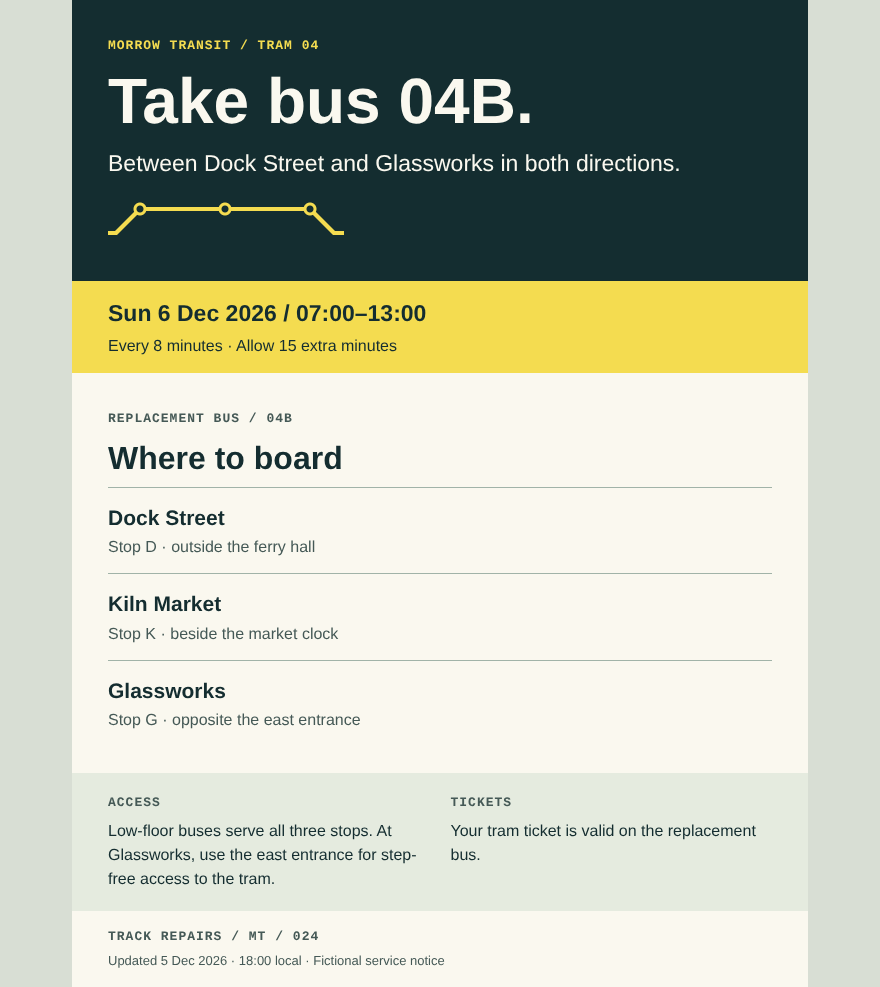

# Transfer Window

A transit dispatcher changes one service notice and gets three things riders can use: a phone-friendly web page, a passenger email and an A4 station poster. All three give the same boarding points, disruption window, ticket information and step-free directions. Both example services and their operator are fictional.



## Open the examples

Open [the web page](out/page.html) or [the email](out/email.html) locally in a browser. [The poster PDF](out/poster.pdf) prints on one A4 page. The [plain-text email](out/email.txt) lists each boarding point in travel order. No external images, fonts or map service are required.

The main example replaces Tram 04 with bus 04B. The [Harbour Metro example](out/harbour/page.html) moves passengers to ferry F2 during a tunnel inspection. It gives pier numbers, ramp access and instructions for showing a metro ticket to the crew. Both examples use the same template.

## Reproduce it

Requires Node.js 22 or newer and npm. In the project folder run:

```sh
npm ci
npm run build
npm test
```

To rebuild the ferry example, run `npm run build -- examples/harbour.json out/harbour`. Set `route` to the affected service and `replacement.mode` and `replacement.line` to what passengers should take instead. The two-way notice lists boarding points in order between its endpoints.

Edit `notice.json` and build again, or pass your own record with `npm run build -- my-notice.json`. The renderer writes the web, email, plain-text and print HTML files into `out/`. To update the PDF, open `out/poster.html` in Chromium and print to PDF using A4, 100% scale, background graphics enabled and browser headers and footers disabled. After adding stops or longer directions, check the print preview for page breaks. Set `sample` to false only when replacing the example with a real service notice.

## How it uses Hyper Elements

`design.mjs` builds one passenger notice with Hyper Elements' Page, Email and Document roots. A shared theme, column layout and stop list keep the route consistent across outputs. The route diagram uses the library's Svg, Path and Circle elements. Each listed stop adds a node. The email retains the full stop list in text. Hyper Elements generates the email tables and mobile layout and validates each template before rendering.

The regression test changes the bus number and adds a new terminus, then checks all three outputs for the new boarding point and the removal of the old bus number. Complete original implementation developed with OpenAI Codex.
